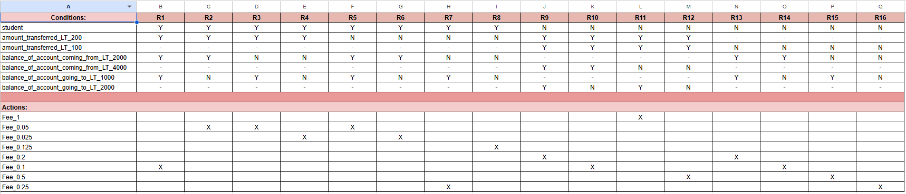

# Assignment 1

## Transfer Fee Test Cases

**Technique:** decision table testing, applied to the transfer fee specification.

We started by reading the spec and pulling out every condition that can change
the fee. After merging the ones that say the same thing in different words, we
summarized them down to 7 conditions:

1. the client is a student
2. the amount transferred is less than $200
3. the amount transferred is less than $100
4. the balance of the account the money comes from is less than $2,000
5. the balance of the account the money comes from is less than $4,000
6. the balance of the account the money goes to is less than $1,000
7. the balance of the account the money goes to is less than $2,000

Going by the formula in the slides, 7 binary conditions would give us 2^7 = 128
rules. Most of those combinations can never happen or don't matter. For example,
the $200 amount limit only applies to students and the $100 limit only applies to
non-students, and an amount can't be both under $100 and not under $200 at once.
The balance limits also change depending on the client type and amount, so only
one "from" limit and one "to" limit are ever relevant for a given rule. Marking
those as "don't care" and dropping the impossible combinations lets us have only
16 rules.

Assumptions we made:

- Fees are a percentage of the amount transferred, so the expected fee in each
  test is the percentage times the amount.
- Each rule gets one representative test case, and the inputs are chosen so
  they sit right at the limits where possible.
- A double tolerance of 1e-9 is used when comparing fees, to ignore tiny
  floating point differences.

The decision table we built from the spec:

Every rule R1 to R16 in the table has one matching test in
`src/test/java/bank/utils/TransferFeeDecisionTableTest.java`, named after the
rule (for example `r1StudentBelow200BothBalancesLow`).

Here is the table for each test:
| Failing test | Suspected fault (file, method, line) | One-line justification |
|---|---|---|
| r1StudentBelow200BothBalancesLow | FeesCalculator.java, calculateTransferFee, L80 (and L81, L103) | Student amount limit is `< 100` instead of `< 200`, and the percentage is too large: a $100 transfer returns fee 2.5 instead of 0.1. |
| r2StudentBelow200FromLowToHigh | FeesCalculator.java, calculateTransferFee, L80 (and L81, L105) | Same wrong amount limit and "from" limit (`< 1000` instead of `< 2000`), so the fee is 1.25 instead of 0.05. |
| r3StudentBelow200FromHighToLow | FeesCalculator.java, calculateTransferFee, L80 (and L102, L103) | $100 falls into the wrong amount group and the percentage is too large: 2.5 instead of 0.05. |
| r4StudentBelow200BothBalancesHigh | FeesCalculator.java, calculateTransferFee, L80 (and L105) | $100 falls into the wrong amount group: 1.25 instead of 0.025. |
| r5StudentAt200BothBalancesLow | FeesCalculator.java, calculateTransferFee, L81 (and L98, L99, L103) | The "from" limit is `< 1000` instead of `< 2000`, and the percentage is far too large: 5.0 instead of 0.1. |
| r6StudentAt200FromLowToHigh | FeesCalculator.java, calculateTransferFee, L95 (and L105) | Wrong "from" limit (`< 1000` instead of `< 2000`) and wrong percentage: 2.5 instead of 0.05. |
| r7StudentAt200FromHighToLow | FeesCalculator.java, calculateTransferFee, L102-L103 | The percentage is wrong: 5.0 instead of 0.5. |
| r8StudentAt200BothBalancesHigh | FeesCalculator.java, calculateTransferFee, L104-L105 | The percentage is wrong: 2.5 instead of 0.25. |
| r9NonStudentBelow100BothBalancesLow | FeesCalculator.java, calculateTransferFee, L111-L112 (and L121) | "From" limit is `< 1000` instead of `< 4000` and "to" limit is `< 1000` instead of `< 2000`, so it lands in the high/high branch: 2.5 instead of 0.1. |
| r10NonStudentBelow100FromLowToHigh | FeesCalculator.java, calculateTransferFee, L111 (and L121) | "From" limit `< 1000` should be `< 4000`, so a $2,000 balance wrongly goes to the high branch: 2.5 instead of 0.05. |
| r11NonStudentBelow100FromHighToLow | FeesCalculator.java, calculateTransferFee, L112, L118 (and L121) | "To" limit `< 1000` should be `< 2000`, so a $1,000 balance is treated as high: 2.5 instead of 0.5. |
| r12NonStudentBelow100BothBalancesHigh | FeesCalculator.java, calculateTransferFee, L118-L121 | The percentage for the high/high case is wrong: 2.5 instead of 0.25. |
| r13NonStudentAt100BothBalancesLow | FeesCalculator.java, calculateTransferFee, L125 (and L131, L133) | "From" limit is `< 1000` instead of `< 2000`, so a $1,000 balance is treated as high: 5.0 instead of 0.2. |
| r14NonStudentAt100FromLowToHigh | FeesCalculator.java, calculateTransferFee, L135 | The high/high percentage `0.055` is wrong, and the "from" limit is also wrong: 5.5 instead of 0.1. |
| r15NonStudentAt100FromHighToLow | FeesCalculator.java, calculateTransferFee, L132-L133 | The percentage is wrong: 5.0 instead of 0.5. |
| r16NonStudentAt100BothBalancesHigh | FeesCalculator.java, calculateTransferFee, L134-L135 | The percentage `0.055` is wrong: 5.5 instead of 0.25. |

## ATM Session (`atm.session.Session`) test cases and results

**Contributor:** Sonia Sharma

### 1. Process and assumptions

The ATM Session cases use Robust Worst Case Boundary Value Analysis under the single fault assumption. Each case varies one input characteristic at a time while keeping the other characteristics at nominal values.

For PIN format, the specification says a PIN contains exactly five digits, each from `0` through `9`. Length cases use numeric characters. Digit cases use five-character inputs and vary one character at a time at, or immediately around, the digit boundaries. `/` and `:` are the adjacent ASCII characters outside the digit range.

For withdrawals, the console ATM must dispense the amount using `$20` and `$50` bills. `$20` is the smallest positive dispensable amount, and `$1,000` is the specified upper boundary. The nominal amount is `$500`. Because cash-dispensable amounts are discrete, `$990` is used as a dispensable value below the upper boundary and `$1,020` as a dispensable value above it, to distinguish the limit check from cash validation.

The lower-bound cases are `$19`, `$20`, and `$21`. Additional robust invalid and denomination cases use `-$20` and `$60`: a negative amount should be rejected, while `$60` is dispensable as three `$20` bills. These cases vary only the amount; the selected transaction remains withdrawal.

The assignment specifies an account with `$5,000` available and a `$1,000` daily limit. The current code has no daily-limit field or API for configuring that account. The withdrawal tests construct an `ATMWithdrawal` and call `Session.setAmount()` with the assignment’s limit as the expected boundary; the session state is stubbed so no bank transaction is performed. These results therefore cover session amount validation, but do not represent a withdrawal against an account configured with the required balance and limit.

For the `$1,020` case, we interpret the specified `$1,000` upper boundary to mean that an over-limit withdrawal amount should be rejected with `InvalidAmountException`, even if it can be dispensed in `$20` and `$50` bills. The handout explicitly associates `InvalidAmountException` with invalid amounts that cannot be dispensed, but does not state the exception or outcome for a cash-dispensable amount above the daily limit. This expected outcome is therefore an assumption for team or TA confirmation. Because the session is tested with a no-op state, the test checks the amount accepted by `Session.setAmount()` and cannot establish the outcome of a bank transaction.

### 2. Test cases

#### PIN format cases

| Test case | Input | Expected result |
|---|---|---|
| `rejectsPinOneDigitBelowRequiredLength` | `1234` | Throw `InvalidPinFormatException` |
| `acceptsPinAtRequiredLength` | `12345` | Accept |
| `rejectsPinOneDigitAboveRequiredLength` | `123456` | Throw `InvalidPinFormatException` |
| `acceptsPinWithDigitAtLowerBoundary` | `01234` | Accept |
| `acceptsPinWithDigitAdjacentToLowerBoundary` | `11234` | Accept |
| `acceptsPinWithDigitAdjacentToUpperBoundary` | `81234` | Accept |
| `acceptsPinWithDigitAtUpperBoundary` | `91234` | Accept |
| `rejectsCharacterImmediatelyBelowDigitRange` | `/12345` | Throw `InvalidPinFormatException` |
| `rejectsCharacterImmediatelyAboveDigitRange` | `:12345` | Throw `InvalidPinFormatException` |

#### Withdrawal amount cases

| Test case | Amount | Expected result |
|---|---:|---|
| `rejectsAmountOneDollarBelowMinimumDispensableAmount` | `$19` | Throw `InvalidAmountException` |
| `rejectsNegativeWithdrawalAmount` | `-$20` | Throw `InvalidAmountException` |
| `acceptsMinimumDispensableAmount` | `$20` | Accept |
| `acceptsAmountDispensableAsThreeTwentyDollarBills` | `$60` | Accept |
| `rejectsAmountOneDollarAboveMinimumDispensableAmount` | `$21` | Throw `InvalidAmountException` |
| `acceptsNominalWithdrawalAmount` | `$500` | Accept |
| `acceptsDispensableAmountImmediatelyBelowDailyLimit` | `$990` | Accept |
| `acceptsAmountAtDailyLimit` | `$1,000` | Accept |
| `rejectsDispensableAmountImmediatelyAboveDailyLimit` | `$1,020` | Throw `InvalidAmountException` |

#### Test results

Results below are from the run on 2026-11-05 reporting 18 tests, 9 failures, and 9 passes.

| Test case | Observed result | Status / notes |
|---|---|---|
| `rejectsPinOneDigitBelowRequiredLength` | Accepted | **Fail.** Four-digit PIN accepted. |
| `acceptsPinAtRequiredLength` | Threw `InvalidPinFormatException` | **Fail.** Five-digit PIN rejected. |
| `rejectsPinOneDigitAboveRequiredLength` | Threw `InvalidPinFormatException` | **Pass.** |
| `acceptsPinWithDigitAtLowerBoundary` | Threw `InvalidPinFormatException` | **Fail, masked.** The length check rejects the five-character PIN before checking the digit. |
| `acceptsPinWithDigitAdjacentToLowerBoundary` | Threw `InvalidPinFormatException` | **Fail, masked.** The length check rejects the five-character PIN before checking the digit. |
| `acceptsPinWithDigitAdjacentToUpperBoundary` | Threw `InvalidPinFormatException` | **Fail, masked.** The length check rejects the five-character PIN before checking the digit. |
| `acceptsPinWithDigitAtUpperBoundary` | Threw `InvalidPinFormatException` | **Fail, masked.** The length check rejects the five-character PIN before checking the digit. |
| `rejectsCharacterImmediatelyBelowDigitRange` | Threw `InvalidPinFormatException` | **Pass, masked.** The five-character PIN is rejected by the incorrect length check, so this result does not establish that `/` was checked. |
| `rejectsCharacterImmediatelyAboveDigitRange` | Threw `InvalidPinFormatException` | **Pass, masked.** The five-character PIN is rejected by the incorrect length check, so this result does not establish that `:` was checked. |
| `rejectsAmountOneDollarBelowMinimumDispensableAmount` | Threw `InvalidAmountException` | **Pass.** |
| `rejectsNegativeWithdrawalAmount` | Accepted | **Fail.** `CashValidator.validateWithdrawal()` treats `-$20` as valid because its remainder checks reach zero. |
| `acceptsMinimumDispensableAmount` | Accepted | **Pass.** |
| `acceptsAmountDispensableAsThreeTwentyDollarBills` | Threw `InvalidAmountException` | **Fail.** `CashValidator.validateWithdrawal()` rejects `$60`, although it can be dispensed as three `$20` bills. |
| `rejectsAmountOneDollarAboveMinimumDispensableAmount` | Threw `InvalidAmountException` | **Pass.** |
| `acceptsNominalWithdrawalAmount` | Accepted | **Pass.** |
| `acceptsDispensableAmountImmediatelyBelowDailyLimit` | Accepted | **Pass.** |
| `acceptsAmountAtDailyLimit` | Accepted | **Pass.** |
| `rejectsDispensableAmountImmediatelyAboveDailyLimit` | Accepted | **Fail.** `Session.setAmount()` accepts `$1,020` in this test path and does not enforce the `$1,000` upper boundary. |

#### Fault localization

The failures below are grouped by suspected fault. Copy these entries into the fault-localization table in the PR description as required by the assignment.

| Failing test case(s) | Suspected fault (file, method, condition) | One-sentence justification |
|---|---|---|
| `rejectsPinOneDigitBelowRequiredLength`; `acceptsPinAtRequiredLength`; `acceptsPinWithDigitAtLowerBoundary`; `acceptsPinWithDigitAdjacentToLowerBoundary`; `acceptsPinWithDigitAdjacentToUpperBoundary`; `acceptsPinWithDigitAtUpperBoundary` | `src/main/java/atm/utils/FormatChecker.java`, `checkPinFormat()`, line 33: `pin.length == 4` | The implementation accepts four-character PINs and rejects the specified five-character PINs; the digit-boundary failures are masked by this length check. |
| `rejectsDispensableAmountImmediatelyAboveDailyLimit` | `src/main/java/atm/session/Session.java`, `setAmount()`, withdrawal branch, lines 87–96 | `Session.setAmount()` accepts `$1,020` in this isolated test path without enforcing the specified `$1,000` upper boundary; treating this as `InvalidAmountException` is an assumption because the handout does not specify the over-limit outcome. |
| `rejectsNegativeWithdrawalAmount` | `src/main/java/atm/utils/CashValidator.java`, `validateWithdrawal()`, lines 20–31 | The remainder checks accept `-$20` because the negative remainder is divisible by `$20`, so `Session.setAmount()` does not throw `InvalidAmountException`. |
| `acceptsAmountDispensableAsThreeTwentyDollarBills` | `src/main/java/atm/utils/CashValidator.java`, `validateWithdrawal()`, lines 23–27 | The validator rejects `$60` even though it can be dispensed as three `$20` bills. |

